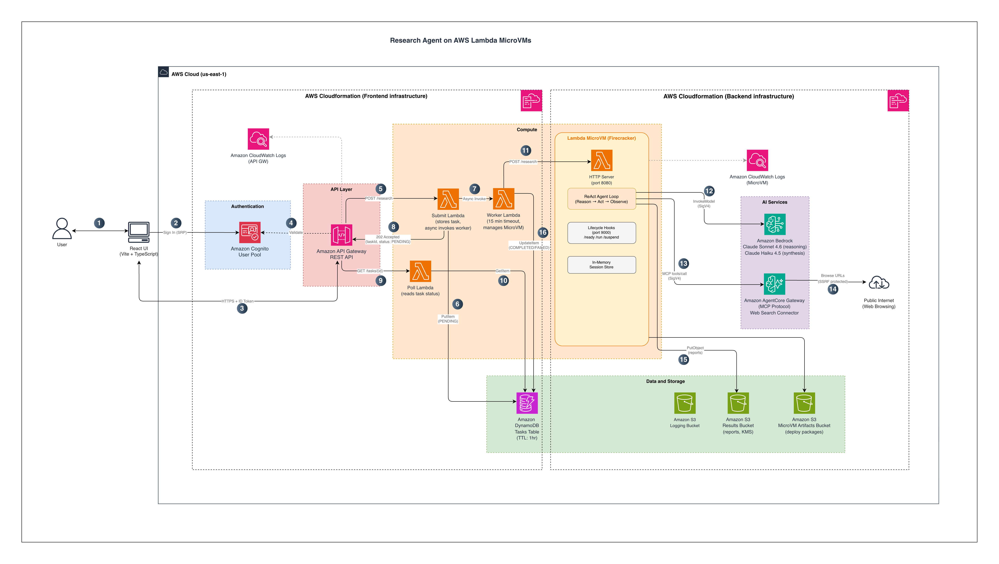

# Research Agent on AWS Lambda MicroVMs

An autonomous AI research agent that runs on AWS Lambda MicroVMs with a React chat interface. It takes a question, searches the web via AgentCore Web Search, reasons about findings using Amazon Bedrock (Claude Sonnet 4.6 for reasoning, Claude Haiku 4.5 for fast synthesis), and produces a structured report.

## Architecture



### Request Flow (numbered in diagram)

1. User types a research question in the React chat interface and hits Send.
2. The frontend authenticates with Amazon Cognito using SRP (Secure Remote Password) protocol and obtains an ID token.
3. The frontend sends a `POST /research` request to the API Gateway REST API, including the Cognito ID token in the Authorization header.
4. API Gateway validates the ID token against the Cognito User Pool using a Cognito authorizer. Invalid tokens are rejected with a 401.
5. After successful authorization, API Gateway invokes the Submit Lambda function with the request payload containing the research task and optional session ID.
6. The Submit Lambda generates a unique task ID, writes an entry to the DynamoDB Tasks Table with status `PENDING` and a 1-hour TTL, ensuring ephemeral storage.
7. The Submit Lambda asynchronously invokes the Worker Lambda (fire-and-forget using `InvocationType: Event`), passing the task ID, research question, and session ID.
8. The Submit Lambda immediately returns a `202 Accepted` response with the task ID to the frontend — this entire flow completes in under 1 second.
9. The frontend begins polling `GET /tasks/{taskId}` every 5 seconds via API Gateway, showing a "Researching..." spinner to the user.
10. Each poll request hits the Poll Lambda, which reads the task record from DynamoDB and returns the current status (`PENDING`, `COMPLETED`, or `FAILED`) along with any report data.
11. The Worker Lambda (15-minute timeout) calls the Lambda MicroVMs API to list running instances. If a MicroVM with the research-agent image is already RUNNING or SUSPENDED, it reuses it. Otherwise, it launches a new one and waits up to 60 seconds for it to reach RUNNING state. It then generates an `X-aws-proxy-auth` token and sends `POST /research` to the MicroVM's HTTP server on port 8080.
12. Inside the MicroVM, the ReAct agent loop begins. The REASON step calls Amazon Bedrock (Claude Sonnet 4.6) via `InvokeModel` with SigV4 authentication to decide what action to take next (search queries, URLs to browse, or finish).
13. The ACT step calls the Amazon Bedrock AgentCore Gateway via MCP protocol (SigV4 authenticated) to perform web searches using the managed Web Search Connector.
14. The agent may also browse specific URLs found in search results. URL browsing includes SSRF protection that validates DNS resolution against private IP ranges before fetching.
15. Once the ReAct loop completes (either by finishing or reaching the max step limit), the agent calls Amazon Bedrock (Claude Haiku 4.5) to synthesize a structured markdown report from the collected findings. The report is then saved as JSON to the S3 Results Bucket (KMS-encrypted, HTTPS-only).
16. The Worker Lambda receives the response from the MicroVM and updates the DynamoDB task record — setting status to `COMPLETED` with the markdown report, or `FAILED` with an error message if anything went wrong. On the next poll cycle (step 9/10), the frontend receives the completed result and renders the formatted markdown report in the chat interface.

## Prerequisites

- **AWS CLI v2.28+** (required for `bedrock-agentcore-control` and `lambda-microvms` commands)
- Node.js 18+ (for the frontend)
- Python 3 with `pip3` (for building the Lambda layer)
- An AWS account with Lambda MicroVMs access (us-east-1)
- Amazon Bedrock model access enabled for Claude Sonnet 4.6 and Claude Haiku 4.5
- Amazon Bedrock AgentCore access (us-east-1)
- `jq` installed (used by deploy script)

### Verify your AWS CLI version

```bash
aws --version
```

If your version is below 2.28, commands like `bedrock-agentcore-control` and `lambda-microvms` will fail with an "Invalid choice" error. Upgrade with:

```bash
# macOS
curl "https://awscli.amazonaws.com/AWSCLIV2.pkg" -o "AWSCLIV2.pkg"
sudo installer -pkg AWSCLIV2.pkg -target /
rm AWSCLIV2.pkg

# Linux
curl "https://awscli.amazonaws.com/awscli-exe-linux-x86_64.zip" -o "awscliv2.zip"
unzip awscliv2.zip && sudo ./aws/install --update
rm -rf aws awscliv2.zip
```

### API Gateway CloudWatch Logs (one-time account setup)

If this is the first time you're using API Gateway access logging in this AWS account, you must configure a CloudWatch Logs role at the account level. Without this, the frontend stack deployment (Step 6) will fail with: *"CloudWatch Logs role ARN must be set in account settings to enable logging."*

```bash
# Create the role
aws iam create-role \
  --role-name ApiGatewayCloudWatchRole \
  --assume-role-policy-document '{
    "Version": "2012-10-17",
    "Statement": [{
      "Effect": "Allow",
      "Principal": {"Service": "apigateway.amazonaws.com"},
      "Action": "sts:AssumeRole"
    }]
  }'

# Attach the managed logging policy
aws iam attach-role-policy \
  --role-name ApiGatewayCloudWatchRole \
  --policy-arn arn:aws:iam::aws:policy/service-role/AmazonAPIGatewayPushToCloudWatchLogs

# Wait for IAM propagation, then set it on the account
sleep 10
aws apigateway update-account \
  --patch-operations op=replace,path=/cloudwatchRoleArn,value=arn:aws:iam::<YOUR_ACCOUNT_ID>:role/ApiGatewayCloudWatchRole \
  --region us-east-1
```

Replace `<YOUR_ACCOUNT_ID>` with your 12-digit AWS account ID. You only need to do this once per account — skip this if you've already configured API Gateway logging.

## Project Structure

```
├── assets/                       # Architecture diagrams
│   ├── architecture-diagram.drawio
│   └── architecture-diagram.png
│
├── research-agent/               # Backend — Agent on Lambda MicroVM
│   ├── infrastructure/
│   │   └── template.yaml         # CloudFormation — IAM roles, S3, AgentCore Gateway
│   ├── agent/
│   │   ├── main.py               # HTTP service + lifecycle hooks + ReAct loop
│   │   ├── llm.py                # Amazon Bedrock integration
│   │   ├── tools.py              # AgentCore Web Search + URL browsing
│   │   └── config.py             # Configuration
│   ├── Dockerfile                # Python 3.12 container for MicroVM
│   ├── requirements.txt
│   └── deploy.sh                 # Build & deploy script
│
├── research-agent-ui/            # Frontend — React Chat Interface
│   ├── infrastructure/
│   │   ├── template.yaml         # CloudFormation — Cognito, API Gateway, Lambdas, DynamoDB
│   │   └── build-layer.sh        # Builds boto3 Lambda layer for lambda-microvms support
│   ├── src/
│   │   ├── components/
│   │   │   ├── Chat.tsx          # Chat interface with session support
│   │   │   ├── Login.tsx         # Sign in / sign up / forgot password
│   │   │   └── MessageBubble.tsx # Markdown-rendered message display
│   │   ├── api.ts                # Async submit + poll client
│   │   ├── config.ts             # Environment-based config (from .env)
│   │   ├── vite-env.d.ts         # Vite env type declarations
│   │   ├── App.tsx               # Root component with auth routing
│   │   ├── main.tsx              # Entry point
│   │   ├── index.css             # Base styles
│   │   └── styles.css            # Component styles + markdown rendering
│   ├── .env.example              # Template for environment variables
│   ├── package.json
│   ├── vite.config.ts
│   ├── tsconfig.json
│   └── index.html
│
├── .gitignore
├── SECURITY.md
└── README.md
```

---

## Deployment

### Step 1: Deploy Backend Infrastructure

```bash
cd research-agent
./deploy.sh infra
```

Creates: S3 buckets (encrypted, logged), IAM roles (least-privilege), AgentCore Gateway (IAM auth).

### Step 2: Add Web Search Target (one-time)

```bash
./deploy.sh add-target
```

Attaches the managed web search connector to the gateway.

### Step 3: Package and Build MicroVM Image

```bash
./deploy.sh package
./deploy.sh create-image
```

Packages your code, uploads to S3, builds a MicroVM image with lifecycle hooks on port 9000.

### Step 4: Launch the MicroVM

```bash
./deploy.sh run "What are the latest breakthroughs in edge computing?"
```

Launches a MicroVM and confirms the agent is running. The frontend Worker Lambda auto-discovers running MicroVMs, so no need to copy endpoints manually.

### Step 5: Build the boto3 Lambda Layer

The Lambda runtime's bundled boto3 doesn't include `lambda-microvms` yet. Build and publish an updated layer:

> **Note:** The build script uses `pip3`. If your system uses `pip` instead, either create an alias (`alias pip3=pip`) or edit `build-layer.sh` to use `pip`.

```bash
cd research-agent-ui/infrastructure

./build-layer.sh

LAYER_ARN=$(aws lambda publish-layer-version \
  --layer-name boto3-latest \
  --zip-file fileb://boto3-layer.zip \
  --compatible-runtimes python3.12 \
  --region us-east-1 \
  --query LayerVersionArn --output text)

echo "Layer ARN: $LAYER_ARN"
```

### Step 6: Deploy Frontend Infrastructure

```bash
cd research-agent-ui

aws cloudformation deploy \
  --stack-name research-agent-ui \
  --template-file infrastructure/template.yaml \
  --parameter-overrides \
    MicroVmImageName="research-agent" \
    MicroVmExecutionRoleArn="<ExecutionRoleArn from Step 1 outputs>" \
    Boto3LayerArn="$LAYER_ARN" \
    AllowedOrigin="http://localhost:5173" \
  --capabilities CAPABILITY_IAM \
  --region us-east-1
```

### Step 7: Get Stack Outputs

```bash
aws cloudformation describe-stacks \
  --stack-name research-agent-ui \
  --query "Stacks[0].Outputs[*].[OutputKey,OutputValue]" \
  --output table --region us-east-1
```

You'll get: `UserPoolId`, `UserPoolClientId`, `ApiEndpoint`.

### Step 8: Configure and Run the UI

Create `research-agent-ui/.env` from the template:

```bash
cp .env.example .env
```

Edit `.env` with the values from step 7:

```env
VITE_COGNITO_USER_POOL_ID=us-east-1_XXXXXXXX
VITE_COGNITO_CLIENT_ID=xxxxxxxxxxxxxxxxxxxxxxxxxx
VITE_API_ENDPOINT=https://xxxxxxxxxx.execute-api.us-east-1.amazonaws.com/prod
```

Then:

```bash
npm install
npm run dev
```

App available at `http://localhost:5173`.

### Step 9: Build for Production

```bash
npm run build
# Deploy dist/ to S3 + CloudFront, Amplify Hosting, or any static host
# Set VITE_* env vars in your CI/CD pipeline
```

---

## API

### POST /research (async submit)
```json
{"task": "What are the top AI frameworks?", "sessionId": null}
```
Returns immediately:
```json
{"taskId": "uuid", "status": "PENDING"}
```

### GET /tasks/{taskId} (poll for result)
```json
{"taskId": "uuid", "status": "COMPLETED", "report": "...", "sessionId": "..."}
```
Status values: `PENDING`, `COMPLETED`, `FAILED`.

---

## How It Works

See the numbered [Request Flow](#request-flow-numbered-in-diagram) above for the detailed step-by-step. In summary:

- **Async pattern**: Submit returns instantly, Worker processes in background (up to 15 min), frontend polls for result
- **Dual-model approach**: Claude Sonnet 4.6 handles reasoning (deciding what to search/browse), Claude Haiku 4.5 handles report synthesis (fast generation)
- **Auto-discovery**: Worker finds running MicroVMs or launches new ones — no hardcoded endpoints
- **Session continuity**: Follow-up questions include `sessionId` so the MicroVM's in-memory session store provides context from previous research
- **Sliding context window**: Only the last 6 messages and 3 recent findings are passed to Bedrock, keeping prompt size bounded regardless of conversation length
- **Auto-suspend/resume**: MicroVMs suspend after 5 min idle, auto-resume on next request

---

## Session-Based Research

The agent maintains conversation history per session. Follow-up questions use previous findings as context:

```bash
# First request — creates a new session
./deploy.sh run "What are the top AI agent frameworks in 2026?"
# Response includes sessionId: "abc-123"

# Follow-up in same session (via CLI)
MICROVM_ID=$(aws lambda-microvms list-microvms --region us-east-1 \
  --query "items[?state=='RUNNING'].microvmId | [0]" --output text)

ENDPOINT=$(aws lambda-microvms get-microvm \
  --microvm-identifier $MICROVM_ID --region us-east-1 \
  --query endpoint --output text)

AUTH_TOKEN=$(aws lambda-microvms create-microvm-auth-token \
  --microvm-identifier $MICROVM_ID --region us-east-1 \
  --expiration-in-minutes 30 \
  --allowed-ports 'allPorts={}' \
  --query 'authToken."X-aws-proxy-auth"' --output text)

curl -s --max-time 300 -X POST "https://${ENDPOINT}/research" \
  -H "X-aws-proxy-auth: ${AUTH_TOKEN}" \
  -H "Content-Type: application/json" \
  -d '{"task":"Compare the top 3","sessionId":"abc-123"}' | python3 -m json.tool
```

Or simply use the chat UI — sessions are managed automatically.

---

## Operational Commands

```bash
# Deploy/update backend infrastructure
cd research-agent && ./deploy.sh infra

# Add web search connector (one-time)
./deploy.sh add-target

# Rebuild image after code changes
./deploy.sh package && ./deploy.sh create-image

# Run a research task (CLI)
./deploy.sh run "your research question"

# Check MicroVM status
./deploy.sh status <microvm-id>

# Connect to shell (debugging)
./deploy.sh shell <microvm-id>
```

---

## Configuration

### Backend (Environment)

| Variable | Description | Default |
|----------|-------------|---------|
| `BEDROCK_MODEL_ID` | Bedrock model for reasoning | `us.anthropic.claude-sonnet-4-6` |
| `BEDROCK_FAST_MODEL_ID` | Bedrock model for synthesis (fast) | `us.anthropic.claude-haiku-4-5` |
| `AGENTCORE_GATEWAY_URL` | AgentCore Gateway MCP endpoint | From CFN outputs |
| `S3_BUCKET` | S3 bucket for results | From CFN outputs |
| `MAX_STEPS` | Maximum reasoning steps per request | `5` |

### Frontend (.env)

| Variable | Description |
|----------|-------------|
| `VITE_COGNITO_USER_POOL_ID` | Cognito User Pool ID |
| `VITE_COGNITO_CLIENT_ID` | Cognito App Client ID |
| `VITE_API_ENDPOINT` | API Gateway endpoint URL |

---

## Security

- **Cognito authentication**: All API requests require a valid Cognito ID token
- **Cognito authorizer**: API Gateway validates tokens before invoking Lambdas
- **No hardcoded secrets**: Frontend config loaded from environment variables (.env gitignored)
- **Explicit CORS origin**: AllowedOrigin is a required parameter (no wildcard default)
- **No public endpoints**: AgentCore Gateway uses AWS_IAM auth; MicroVM requires auth token
- **Auto-discovery**: No hardcoded MicroVM endpoints — Worker finds or launches them dynamically
- **SSRF protection**: URL browsing validates DNS resolution against private IPs
- **Least-privilege IAM**: Each Lambda has its own scoped role (submit, poll, worker)
- **Encrypted storage**: S3 (AES256/KMS), DynamoDB (KMS), HTTPS-only policies
- **DynamoDB TTL**: Task records auto-expire after 1 hour
- **Isolated execution**: Each MicroVM runs in its own Firecracker VM with full isolation
- **Non-root container**: Agent runs as unprivileged user inside the container
- **API throttling**: Usage plan with rate limits on API Gateway

See [CONTRIBUTING](CONTRIBUTING.md#security-issue-notifications) for more information.
---

## Cost Estimate

| Component | Cost |
|-----------|------|
| MicroVM (running) | ~$0.001/min |
| MicroVM (suspended) | minimal storage |
| Bedrock Claude Sonnet 4.6 (reasoning) | ~$3/1M input, ~$15/1M output tokens |
| Bedrock Claude Haiku 4.5 (synthesis) | ~$0.80/1M input, ~$4/1M output tokens |
| AgentCore Web Search | $7/1,000 queries |
| Cognito | Free tier up to 50k MAU |
| API Gateway | $3.50/million requests |
| DynamoDB | Free tier covers most usage |
| Lambda (Submit/Poll) | negligible |
| Lambda (Worker) | ~$0.002 per research task |
| Single research task (~2 min) | ~$0.01–0.05 |

---

## Troubleshooting

- **"Invalid choice" from AWS CLI**: Your CLI version is too old. Run `aws --version` — you need v2.28+. See the [Prerequisites](#verify-your-aws-cli-version) section for upgrade instructions.
- **"CloudWatch Logs role ARN must be set in account settings"**: Your AWS account hasn't been configured for API Gateway access logging yet. See the [API Gateway CloudWatch Logs](#api-gateway-cloudwatch-logs-one-time-account-setup) setup in Prerequisites.
- **`pip: command not found` during `build-layer.sh`**: Your system uses `pip3` instead of `pip`. The script has been updated to use `pip3`, but if you're on an older version, edit `build-layer.sh` to use whichever is available.
- **Bedrock access denied**: Verify the execution role has `bedrock:InvokeModel` on both `foundation-model` and `inference-profile` ARNs.
- **Web search not working**: Ensure `AGENTCORE_GATEWAY_URL` is set. Run `./deploy.sh add-target` if not done already.
- **Image build fails**: Check logs with `./deploy.sh create-image`.
- **MicroVM terminates immediately**: Check runtime logs in CloudWatch `/aws/lambda-microvms/research-agent`.
- **UI auth errors**: Confirm `.env` values match CloudFormation outputs.
- **CORS errors**: Ensure `AllowedOrigin` parameter matches your frontend URL exactly.
- **Task stuck in PENDING**: Check Worker Lambda logs: `aws logs tail /aws/lambda/research-agent-ui-worker --since 10m --region us-east-1`
- **Task FAILED**: Poll the task to see the error: `GET /tasks/{taskId}` returns an `error` field.

---

## Cleanup

```bash
# Delete UI stack
aws cloudformation delete-stack --stack-name research-agent-ui --region us-east-1

# Delete backend stack
aws cloudformation delete-stack --stack-name research-agent-infra --region us-east-1
```

## License

This library is licensed under the MIT-0 License. See the LICENSE file.

